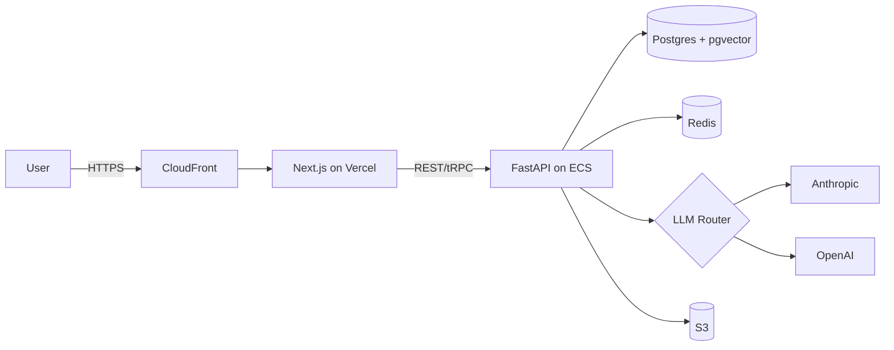

# 00 — The SoftCo Workflow (Detailed)

Authoritative phase-by-phase guide. Load this at the start of any new project
or when re-entering an existing one in audit / fix / extend mode.

---

## Phase 0 — Discovery

**Goal**: produce a `Requirements Summary` the user signs off on.

### Interview script (sequence, not bulk)

**Turn 1 — product shape**

```
1. Product type? [SaaS web / mobile / internal tool / API / CLI / desktop]
2. Target users and rough scale? [10s / 100s / 10k+ / public]
3. Hard constraints? [budget / cloud lock / on-prem / compliance: HIPAA, SOC2, GDPR, PCI]
```

**Turn 2 — core workflows**

```
4. List 3–5 things a primary user must be able to do.
5. Any "must integrate with" systems? (Slack, Stripe, existing DB, ERP, etc.)
6. Any data sensitivity? (PII, PHI, financial, none)
```

**Turn 3 — AI / intelligence (always ask, even if not requested)**

```
7. Does any flow benefit from LLM / ML? (suggestions / search / extraction /
   chat / classification / generation) — propose 2–3 concrete uses if user
   unsure
8. Latency tolerance for AI responses? (sub-second / a few seconds / async OK)
9. Cost ceiling for AI per active user per month?
```

**Turn 4 — non-functional**

```
10. SLA expectations? (best-effort / 99% / 99.9%)
11. Multi-tenant or single-tenant?
12. Deployment preference? [AWS / GCP / Azure / DO / Fly / Render / Vercel /
    self-hosted / no preference]
```

### Output — `Requirements Summary`

```markdown
# Requirements Summary — <project>

## Product
- Type:
- Primary users:
- Core workflows: (3–5 bullets)

## Functional requirements
- F1. <user-facing capability>
- F2. ...

## Non-functional
- NFR1. Scale: <users / RPS / data volume>
- NFR2. Latency: ...
- NFR3. Availability: ...
- NFR4. Compliance: ...

## Integrations
- ...

## AI capabilities
- AI1. <use case> — model class: <routing|reasoning|generation> — latency budget — cost budget

## Constraints
- Budget: $X / month
- Cloud: <pref>
- Timeline: <if known>

## Out of scope
- ...

## Open questions
- ...
```

Halt. Wait for explicit "approved" / "go" before Phase 1.

---

## Phase 1 — Architecture & TDR

**Goal**: a Tech Stack Decision Record the user approves.

### Process

1. Map each functional requirement to a system component.
2. Identify shared services: auth, file storage, queue, cache, search,
   vector store.
3. Choose stack per component using `SKILL.md §17` defaults unless requirement
   forces otherwise.
4. For each non-default choice, write a trade-off block in the TDR.
5. Estimate monthly cost (load `assets/` cost references; use real pricing
   pulled via `WebFetch` if cost is a hard constraint).
6. Identify top 3 risks and mitigations.

### TDR skeleton

See `SKILL.md §4`. Save as `docs/TDR-0001-stack.md`.

### Architecture diagram

Produce Mermaid in `docs/ARCHITECTURE.md`:



Halt. Wait for approval.

---

## Phase 2 — Documentation First

**Rule**: not a single `.py` / `.ts` / `.go` file until docs exist.

Order of creation:

1. `README.md` — what, why, quickstart
2. `AGENT.md` — single source of truth (see `SKILL.md §14`)
3. `ARCHITECTURE.md` — diagram, components, data flow
4. `DB_SCHEMA.md` — entity tables, columns, types, indexes, FKs
5. `API.md` — every endpoint: method, path, auth, req schema, res schema,
   error codes
6. `MODULES.md` — module list with one-line purpose + dependencies
7. `ENV.md` — every variable with description + source
8. `INFRA.md` — resources, Terraform module list, cost
9. `TESTING.md` — strategy, run commands
10. `CHANGELOG.md` — `## [0.1.0] - YYYY-MM-DD\n- Initial scaffold`

Templates in `references/11-doc-templates.md`.

Also create:

- `.env.example` (every var documented in `ENV.md` appears here, empty values)
- `.gitignore` (language-appropriate + `.env`)
- `LICENSE` (ask user; default MIT)
- `Makefile` with targets: `setup`, `dev`, `test`, `lint`, `build`, `deploy`

Commit at end of Phase 2 with `docs: initial documentation package`.

---

## Phase 3 — Module-by-Module Build

### Module ordering heuristic

1. **Foundations first**: config loading, logging, DB connection, migrations
2. **Data layer**: models, repositories
3. **Domain layer**: services / use-cases
4. **Edge layer**: HTTP/CLI handlers
5. **Cross-cutting**: auth middleware, rate limit, CORS
6. **AI features last** (depend on data + domain)
7. **Frontend after API contract is stable** (or parallel with mock server)

### Per-module loop

```
for module in modules:
    1. Open docs/MODULES.md → confirm scope
    2. Write failing tests (red)
    3. Implement minimum code to pass (green)
    4. Refactor (still green)
    5. Run lint + type-check + tests
    6. Update AGENT.md "Current status"
    7. Commit: feat(<scope>): <module name>
    8. Present diff summary, ask "next?"
```

Never combine modules. Never skip the failing-test step.

---

## Phase 4 — Testing (runs alongside Phase 3)

### Coverage matrix

| Layer       | Type        | Tool                          | Target  |
| ----------- | ----------- | ----------------------------- | ------- |
| Pure funcs  | Unit        | pytest / vitest / go test     | 95%     |
| Services    | Unit + mock | same + respx / msw / httptest | 90%     |
| Repos       | Integration | real DB in Docker             | 85%     |
| HTTP        | Integration | TestClient / supertest        | 100% of routes |
| E2E         | Browser     | Playwright                    | All critical flows |
| AI          | Regression  | Promptfoo / pytest snapshots  | All prompts |

CI enforces ≥ 80% line coverage. Block merge below threshold.

### AI testing specifics

- Snapshot known inputs → expected outputs
- Adversarial inputs: prompt injection, jailbreaks, empty, oversized
- Structured output validation: schema must always parse
- Cost regression: track tokens per test run

Load `references/09-testing.md` and `references/10-prompt-engineering.md`.

---

## Phase 5 — Infrastructure

### Layout

```
infra/
├── modules/
│   ├── network/
│   ├── compute/
│   ├── database/
│   ├── cache/
│   ├── storage/
│   └── observability/
└── environments/
    ├── dev/
    ├── staging/
    └── prod/
```

Each environment composes modules with environment-specific vars.

### Rules

- State in remote backend (S3 + DynamoDB lock, or GCS, or Terraform Cloud)
- `terraform fmt` + `tflint` + `tfsec` in CI
- `terraform plan` posted to PR via Atlantis or GitHub Action
- Apply only on merge to `main` (dev), tag (prod)
- Secrets injected via Secrets Manager / SSM / Vault — never in `.tfvars`

Module stubs: `assets/terraform-modules/`. Patterns:
`references/05-infrastructure.md`.

---

## Phase 6 — CI/CD

### Pipeline stages

```yaml
jobs:
  lint:         # eslint, ruff, golangci-lint
  type-check:   # tsc --noEmit, mypy, staticcheck
  test:         # unit + integration; upload coverage
  build:        # docker buildx, push to GHCR/ECR
  scan:         # trivy image scan; fail on HIGH+
  deploy-dev:   # on push to main
  e2e:          # playwright against dev URL
  deploy-prod:  # on tag v*; manual approval gate
```

Workflow YAML templates in `assets/github-actions-templates/`.

### Deploy targets

| Target          | Mechanism                              |
| --------------- | -------------------------------------- |
| ECS Fargate     | `aws ecs update-service` via OIDC role |
| Cloud Run       | `gcloud run deploy` via WIF            |
| Kubernetes      | `helm upgrade` or `kubectl apply -k`   |
| Fly.io          | `flyctl deploy --remote-only`          |
| Vercel          | git integration                        |

Always: health-check gate, automatic rollback on failure.

---

## Audit Mode (existing repo)

When user says "review / audit / improve this":

1. **Map the repo**: read top-level files, `package.json` / `pyproject.toml` /
   `go.mod`, list services and modules
2. **Read docs that exist**: `README`, any `ARCHITECTURE` / `AGENT`
3. **Identify deltas vs SoftCo standard**:
   - Missing docs?
   - No tests / low coverage?
   - Secrets in repo?
   - No CI?
   - No IaC?
4. **Produce `docs/AUDIT.md`**:
   ```markdown
   # Audit — <repo> — <date>

   ## Snapshot
   - Lang: ...
   - LOC: ...
   - Test coverage: ...
   - Last commit: ...

   ## Findings
   ### Critical
   - ...
   ### High
   - ...
   ### Medium
   - ...

   ## Proposed remediation plan
   - Phase A (1 day): ...
   - Phase B (1 week): ...
   ```
5. Wait for user to choose remediation scope.

---

## Fix Mode

1. Reproduce — run failing test or steps locally
2. Identify root cause; name it (not "race condition somewhere" — name file +
   line + invariant violated)
3. Write a failing test that captures the bug
4. Minimum-diff fix
5. Test passes
6. Add regression note in `CHANGELOG.md`
7. Commit `fix(<scope>): <one-line>` with body explaining root cause

---

## Extend Mode

For "add feature X to existing app":

1. Scope: 30-second mini Phase 0 (one question batch if needed)
2. Update `docs/MODULES.md` with new module
3. Update `docs/ARCHITECTURE.md` if shape changes
4. Update `docs/API.md` + `docs/DB_SCHEMA.md` if relevant
5. Standard Phase 3 loop for the new module
6. Update `AGENT.md` "Current status" + `CHANGELOG.md`
7. Open PR

Never add a feature without updating these docs.

---

## Stop Conditions

Pause and ask user when:

- A decision affects monthly cost by > 20% of stated budget
- A choice locks in a vendor (cloud, auth provider, payment processor)
- A change touches authentication, authorisation, or payment code
- Data migration is destructive (drop column, table rename, type change)
- More than one third-party SaaS is added in one phase
