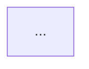
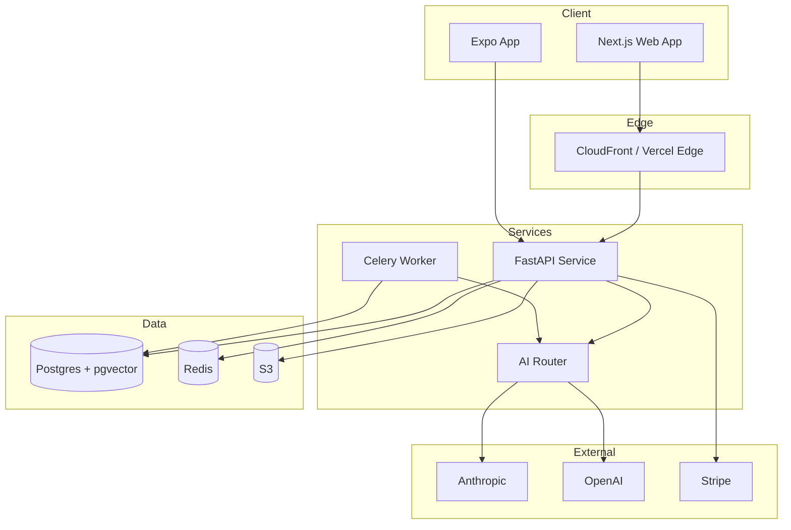
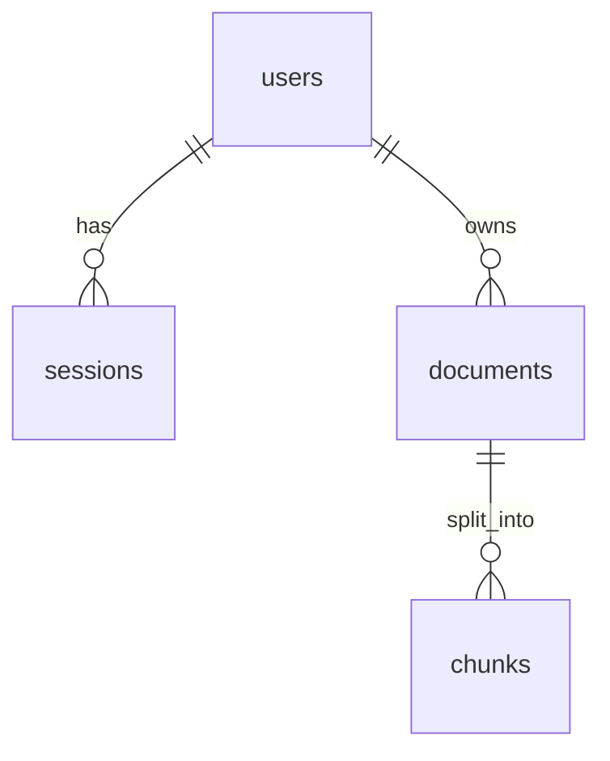

# 11 — Documentation Templates

Copy-paste-fill templates for every doc SoftCo produces in Phase 2. Keep
language plain. Senior dev reads cold; no ambiguity.

---

## Contents

- [README.md](#readmemd)
- [AGENT.md](#agentmd)
- [ARCHITECTURE.md](#architecturemd)
- [API.md](#apimd)
- [DB_SCHEMA.md](#db_schemamd)
- [ENV.md](#envmd)
- [INFRA.md](#inframd)
- [MODULES.md](#modulesmd)
- [TESTING.md](#testingmd)
- [CHANGELOG.md](#changelogmd)
- [ADR template](#adr-template-docstdr-xxxx-slugmd)

---

## README.md

```markdown
# <Project Name>

<One sentence: what this is and who it's for.>

## Status
Version: 0.1.0 — <alpha | beta | stable>

## Features
- ...
- ...

## Tech stack
- Frontend: <stack>
- Backend: <stack>
- Database: <stack>
- AI: <providers, frameworks>
- Infra: <cloud + container>

## Quickstart

```bash
# 1. Clone
git clone <repo>
cd <repo>

# 2. Configure
cp .env.example .env
# Fill values — see docs/ENV.md for each variable

# 3. Run
make setup       # one-time: install deps, init DB
make dev         # start full stack via docker compose
```

Open http://localhost:3000.

## Project layout
See `docs/MODULES.md`.

## Development
- `make test` — run all tests
- `make lint` — lint + type-check
- `make build` — build Docker images
- `make deploy` — deploy to current env (see `docs/INFRA.md`)

## Documentation
- [AGENT.md](docs/AGENT.md) — single source of truth for AI agents
- [ARCHITECTURE.md](docs/ARCHITECTURE.md) — system design
- [API.md](docs/API.md) — API reference
- [DB_SCHEMA.md](docs/DB_SCHEMA.md) — database schema
- [ENV.md](docs/ENV.md) — environment variables
- [INFRA.md](docs/INFRA.md) — infrastructure
- [TESTING.md](docs/TESTING.md) — test strategy

## License
<MIT | Apache-2.0 | proprietary>
```

---

## AGENT.md

```markdown
# AGENT.md

> Single source of truth for any AI agent (Claude, Cursor, future SoftCo
> session) picking up this project. Update at end of every phase.

## 1. Project purpose
<Two sentences, max.>

## 2. Architecture overview
<Mermaid diagram or bullet list. Match docs/ARCHITECTURE.md.>



## 3. Run locally

```bash
cp .env.example .env
# Edit .env — see §4 below for each variable
make setup
make dev
```

Services:
- Frontend: http://localhost:3000
- API: http://localhost:8000
- DB: postgres on :5432
- ...

## 4. Environment variables

| Name              | Required | Description                          | Where to get it          |
| ----------------- | -------- | ------------------------------------ | ------------------------ |
| `DATABASE_URL`    | yes      | Postgres connection string           | docker-compose default   |
| `ANTHROPIC_API_KEY` | yes    | Claude API key                       | console.anthropic.com    |
| `JWT_SECRET`      | yes      | Signing key for access tokens        | generate: `openssl rand -hex 32` |
| ...               |          |                                      |                          |

## 5. Module map

| Path                | Purpose                                       |
| ------------------- | --------------------------------------------- |
| `apps/web/`         | Next.js frontend                              |
| `apps/api/`         | FastAPI backend                               |
| `packages/db/`      | SQLAlchemy models + Alembic migrations        |
| `packages/ai/`      | LLM router, prompts, agent loops              |
| `infra/`            | Terraform                                     |
| `docs/`             | All documentation                             |
| ...                 |                                               |

## 6. Current status

### Done
- [x] M1 — DB schema + migrations
- [x] M2 — Auth (JWT)

### In progress
- [ ] M3 — User profile API

### Next
- [ ] M4 — File upload
- [ ] M5 — Chat module (RAG)

## 7. AI agent design (if applicable)

- **Role**: <e.g. "support assistant for billing questions">
- **Tools**: `search_kb`, `lookup_invoice`, `escalate_to_human`
- **Memory**: short-term: last 20 turns; long-term: pgvector on `kb_chunks`
- **LLM routing**:
  - Intent classification → Haiku
  - Generation → Sonnet
  - Hard reasoning / multi-step plans → Opus
- **Guardrails**: prompt injection filter on user input; output validator
  against `BillingAnswer` Pydantic schema
- **Observability**: Langfuse traces on every call

## 8. Known issues / gotchas
- ...
- ...

## 9. Testing
- `make test` — full suite
- `make test-unit` — unit only
- `make test-e2e` — Playwright (requires `make dev` running)
- Coverage minimum: 80%
- AI prompt regression: `pytest tests/ai/test_prompts.py`

## 10. Deploy

```bash
# Dev (auto on merge to main)
gh pr merge

# Prod (tag triggers workflow)
git tag v0.2.0
git push --tags
# Approve in GitHub Actions UI
```

Rollback: re-tag previous version or use `make rollback ENV=prod`.

## 11. Open decisions / TDRs
- `docs/TDR-0001-stack.md`
- `docs/TDR-0002-llm-routing.md`
- ...
```

---

## ARCHITECTURE.md

```markdown
# Architecture

## System diagram



## Component responsibilities

- **Web (Next.js)**: SSR landing + authenticated dashboard. Server actions for
  mutations; TanStack Query for data fetching.
- **API (FastAPI)**: All business logic. REST + websocket for chat.
- **Worker (Celery)**: Long-running jobs — embeddings, batch ingestion,
  scheduled reports.
- **AI Router**: Unifies LLM providers. Routes by model class (see AGENT.md
  §7).
- **Postgres**: System-of-record + pgvector for embeddings.
- **Redis**: Cache + Celery broker.
- **S3**: User uploads, generated artifacts.

## Data flow — primary user journey

1. User uploads document → S3 (signed URL) → API stores metadata in PG
2. API enqueues embedding job → Celery → AI Router → chunks + embeddings → PG
3. User chat query → API → AI Router (Haiku for retrieval planning + Sonnet
   for answer) → streaming response back to Web

## Failure modes & resilience
- LLM timeout: retry with exponential backoff (2 attempts), then fall back to
  cheaper model, then return graceful error
- DB unavailable: API returns 503 with `Retry-After`
- S3 upload fail: client retries via signed URL
```

---

## API.md

```markdown
# API Reference

Base URL: `https://api.<env>.<domain>` — local: `http://localhost:8000`
Auth: `Authorization: Bearer <jwt>` unless marked `public`.

## Conventions
- All requests/responses JSON unless multipart upload
- Timestamps ISO-8601 UTC
- Errors:
  ```json
  { "error": { "code": "INVALID_INPUT", "message": "...", "details": {} } }
  ```
- Pagination: `?cursor=<opaque>&limit=<int, max 100>`
- Rate limit: 100 req/min/user; headers `X-RateLimit-*`

## Endpoints

### `POST /auth/login` — public
Request:
```json
{ "email": "string", "password": "string" }
```
Response 200:
```json
{ "access_token": "string", "refresh_token": "string", "expires_in": 3600 }
```
Errors: 401 `INVALID_CREDENTIALS`

### `GET /me`
Response 200:
```json
{ "id": "uuid", "email": "string", "name": "string" }
```

<repeat for every endpoint>
```

---

## DB_SCHEMA.md

```markdown
# Database Schema

Engine: Postgres 16 + pgvector 0.7

## Entity-relationship diagram



## Tables

### `users`
| Column      | Type        | Constraints              | Notes              |
| ----------- | ----------- | ------------------------ | ------------------ |
| id          | uuid        | pk, default gen_random_uuid() |               |
| email       | text        | not null, unique         |                    |
| password_hash | text      | not null                 | argon2id           |
| created_at  | timestamptz | not null, default now()  |                    |

Indexes: `users_email_idx (email)` (unique above gives this).

### `documents`
...

## Migrations
Managed by Alembic. Files in `packages/db/migrations/versions/`.
Conventions: `<timestamp>_<verb>_<noun>.py`.
```

---

## ENV.md

```markdown
# Environment Variables

Every variable below appears in `.env.example` with an empty value or sane
default. The app refuses to start if a required var is missing (see
`packages/core/config.py`).

## Required

| Name              | Description                          | Where to get / how to generate |
| ----------------- | ------------------------------------ | ------------------------------ |
| `DATABASE_URL`    | Postgres DSN                         | docker-compose default; in prod from RDS endpoint |
| `REDIS_URL`       | Redis URL                            | docker-compose default          |
| `JWT_SECRET`      | Access token signing key             | `openssl rand -hex 32`          |
| `ANTHROPIC_API_KEY` | Claude API                         | console.anthropic.com           |
| ...               |                                      |                                |

## Optional

| Name              | Default | Description                          |
| ----------------- | ------- | ------------------------------------ |
| `LOG_LEVEL`       | INFO    | DEBUG / INFO / WARN / ERROR          |
| `OPENAI_API_KEY`  | (none)  | Fallback LLM provider                |
```

---

## INFRA.md

```markdown
# Infrastructure

## Cloud target
<AWS | GCP | Azure | DO | Fly | Render>

## Terraform layout
See `infra/`. Modules: `network`, `compute`, `database`, `cache`, `storage`,
`observability`. Environments: `dev`, `staging`, `prod`.

## Resources (prod, expected)

| Resource              | Type                       | Sized for             | Est. cost / mo |
| --------------------- | -------------------------- | --------------------- | -------------- |
| API service           | ECS Fargate, 2× 0.5vCPU/1GB | 100 RPS sustained     | $25            |
| Worker service        | ECS Fargate, 1× 1vCPU/2GB  | 50 jobs/min           | $30            |
| Postgres              | RDS db.t4g.small Multi-AZ  | 100GB                 | $90            |
| Redis                 | ElastiCache cache.t4g.micro| —                     | $15            |
| S3                    | Standard                   | 50GB + 10k req/day    | $5             |
| CloudWatch logs       | 5GB ingest                 | —                     | $5             |
| **Total**             |                            |                       | **~$170/mo**   |

## Deploy
1. `cd infra/environments/<env> && terraform init && terraform plan`
2. Approve & merge → GitHub Action runs `terraform apply`
3. App deploy follows automatically (see Phase 6 pipeline)

## Rollback
- Infra: `terraform apply` on previous tag
- App: re-tag previous image SHA and trigger deploy workflow
- DB migration: backwards-compatible migrations only; if irreversible, restore
  from PITR snapshot

## Disaster recovery
- RDS: PITR enabled, 7-day retention
- S3: versioning + lifecycle to Glacier after 90 days
- IaC: Terraform state versioned in S3 + DynamoDB lock
```

---

## MODULES.md

```markdown
# Modules

Build order top-to-bottom. Each module: tests-first, single concern, listed
deliverables.

## M1 — Core config
- `packages/core/config.py` — env loader, Pydantic Settings
- `packages/core/logging.py` — structlog setup
- Deliverables: importable settings object, JSON log output
- Tests: env required vs optional, log format

## M2 — DB schema + migrations
- `packages/db/models/*.py` — SQLAlchemy models
- `packages/db/migrations/` — Alembic
- Tests: migration up/down idempotent

## M3 — Auth
- `apps/api/auth/` — JWT issue/verify, refresh rotation, password hashing
  (argon2id)
- Tests: happy path, expired token, replay, brute-force lockout

<continue>
```

---

## TESTING.md

```markdown
# Testing

## Strategy
- Unit: pure functions, services with mocked deps
- Integration: real DB in Docker; uses Testcontainers
- E2E: Playwright against `make dev` stack
- AI: prompt regression with Promptfoo + structured-output schema tests

## Coverage targets
- Overall: ≥ 80% lines, enforced in CI
- Critical paths (auth, payments): 100%

## Run

```bash
make test            # all
make test-unit
make test-int        # spins up testcontainers
make test-e2e        # requires `make dev` running
make test-ai         # snapshot + adversarial
```

## CI
`.github/workflows/test.yml` runs on every PR. Coverage reported to Codecov.
Block merge below threshold.

## Adding a test
1. Find or create `tests/<module>/test_<thing>.py`
2. Pattern: arrange / act / assert
3. Fixtures in `tests/conftest.py`
4. AI tests: add prompt + expected schema to `tests/ai/cases/`
```

---

## CHANGELOG.md

```markdown
# Changelog

All notable changes to this project. Format: Keep a Changelog. Versioning:
SemVer.

## [Unreleased]

## [0.1.0] - YYYY-MM-DD
### Added
- Initial scaffold: docs, infra skeleton, CI baseline
```

---

## ADR template (`docs/TDR-XXXX-<slug>.md`)

```markdown
# TDR-0001 — <Decision title>

Status: proposed | accepted | superseded by TDR-XXXX
Date: YYYY-MM-DD

## Context
<What forces this decision now? What constraints apply?>

## Decision
<The choice, in one sentence.>

## Options considered
1. <A> — pros / cons
2. <B> — pros / cons
3. <C> — pros / cons

## Consequences
- Positive: ...
- Negative: ...
- Reversible? <yes / no, and how>

## Follow-ups
- [ ] ...
```
